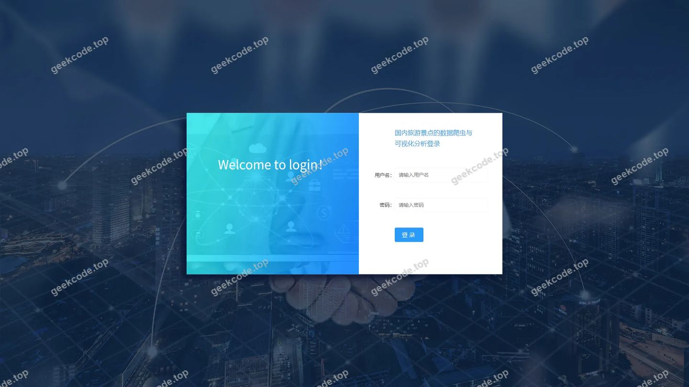
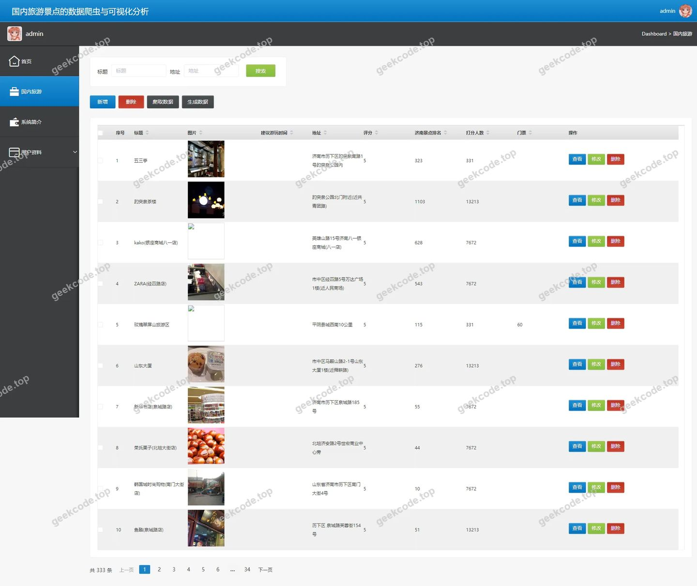
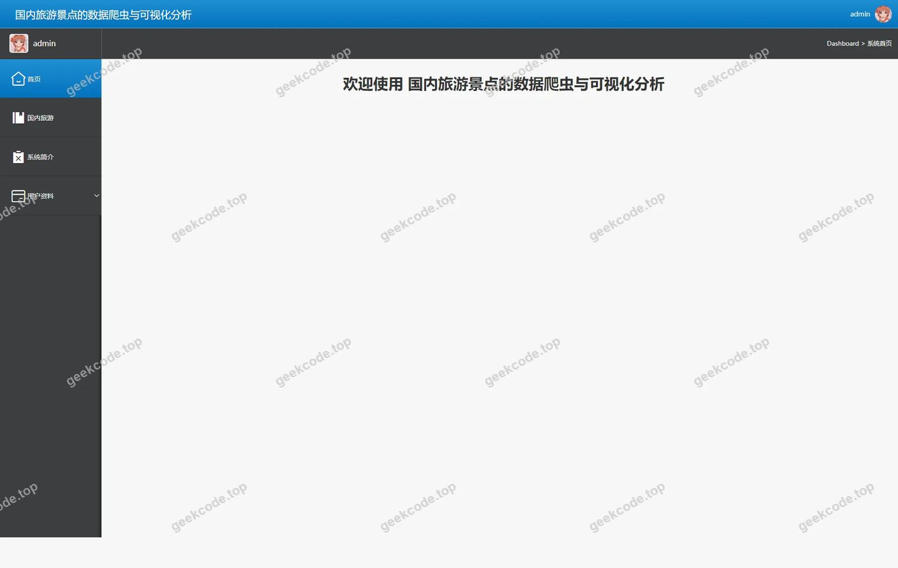
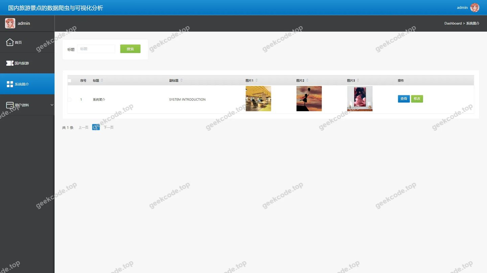

# 国内旅游景点的数据爬虫与可视化分析

> 🎓 **计算机毕业设计 · 国内旅游景点的数据爬虫与可视化分析**
>
> 本仓库只放**项目介绍 + 运行截图**（截图是站点带水印的原图，存在仓库 `images/` 里）。
>
> 👉 **完整可运行源码 / 数据库脚本 / 部署文档：[点我获取](https://geekcode.top/archives/%E5%9B%BD%E5%86%85%E6%97%85%E6%B8%B8%E6%99%AF%E7%82%B9%E7%9A%84%E6%95%B0%E6%8D%AE%E7%88%AC%E8%99%AB%E4%B8%8E%E5%8F%AF%E8%A7%86%E5%8C%96%E5%88%86%E6%9E%90?utm_source=github)**
>
> 💬 咨询微信：**ir9372**　|　🌐 更多项目：[极客代码 geekcode.top](https://geekcode.top/?utm_source=github)
>
> 📌 项目详情页：<https://geekcode.top/archives/%E5%9B%BD%E5%86%85%E6%97%85%E6%B8%B8%E6%99%AF%E7%82%B9%E7%9A%84%E6%95%B0%E6%8D%AE%E7%88%AC%E8%99%AB%E4%B8%8E%E5%8F%AF%E8%A7%86%E5%8C%96%E5%88%86%E6%9E%90?utm_source=github>

<table><td width="230" align="center"> <b>扫码加微信 ir9372</b></td><td valign="middle">📦 源码 = 项目介绍 + 全部运行截图 + 数据库 + 部署文档 👉 点上方任意截图，直接跳到 <b>极客代码 geekcode.top</b> 详情页</td></table>

---

<h1>国内旅游景点的数据爬虫与可视化分析</h1>
<h2>项目概述</h2>

本项目名为“国内旅游景点的数据爬虫与可视化分析”，旨在构建一个基于 Spring Boot 架构的后台管理系统，用于集中管理从互联网获取的国内旅游景点数据。系统核心功能聚焦于济南旅游（jinanlvyou）相关数据的录入、维护与展示，以及系统基础信息的配置与管理。该项目主要面向系统管理员及数据运营人员，通过提供简洁高效的管理界面，实现对景点数据的结构化存储与初步可视化呈现。技术架构上采用前后端分离模式，后端基于 Spring Boot 生态，集成 MyBatis-Plus 进行持久层操作，使用 Shiro 保障系统安全，前端采用 Vue 框架实现交互逻辑，整体设计轻量且易于扩展。

<h2>技术架构</h2>
<h3>总体架构</h3>

本项目采用典型的 B/S（浏览器/服务器）架构，遵循前后端分离的开发模式。

<ul>
<li><strong>后端服务</strong>：基于 Java 语言开发，核心框架为 Spring Boot，利用其自动配置特性快速搭建应用骨架。持久层采用 MyBatis-Plus，简化了 CRUD 操作的代码量；数据库连接池使用 Druid，以监控 SQL 执行性能并防止注入攻击；权限控制模块引入 Apache Shiro，实现用户认证与授权管理。</li>
<li><strong>前端展示</strong>：虽然项目标记为 <code>vue-integrated</code> 类型，但根据路由配置仅存在后台路径 <code>/systemintro</code>, <code>/jinanlvyou</code>, <code>/board</code> 等，且无前台路由，表明前端主要服务于后台管理界面。Vue.js 负责页面渲染与数据双向绑定，通过 HTTP 请求与后端 Controller 交互。</li>
<li><strong>数据存储</strong>：使用 MySQL 作为关系型数据库，存储用户信息、景点数据及系统配置项。</li>
</ul>
<h3>核心技术选型理由</h3>
<ol>
<li><strong>Spring Boot</strong>：提供开箱即用的微服务基础，减少配置复杂度，适合毕业设计快速迭代。</li>
<li><strong>MyBatis-Plus</strong>：在保留 MyBatis 灵活性的同时，提供了通用的 Mapper 和 Service 接口，显著提升开发效率。</li>
<li><strong>Shiro</strong>：相比 Spring Security，Shiro 更轻量级，易于理解和使用，适合中小型项目的权限管理需求。</li>
<li><strong>Druid</strong>：阿里开源的高性能数据库连接池，具备强大的监控功能，有助于排查数据库性能瓶颈。</li>
</ol>
<h3>数据库设计要点</h3>

根据 Controller 列表推断，数据库主要包含以下实体表：

<ul>
<li><strong>Users 表</strong>：存储管理员或注册用户信息，包括账号、密码、角色等字段，支撑登录与权限验证。</li>
<li><strong>Jinanlvyou 表</strong>：核心业务表，存储济南旅游景点的详细数据，如名称、描述、图片路径、地理位置等。</li>
<li><strong>Systemintro 表</strong>：存储系统简介、公告或帮助文档内容，用于后台首页或介绍页展示。</li>
<li><strong>Config/File 表</strong>：可能涉及系统参数配置及文件上传记录（对应 FileController）。</li>
</ul>
<h2>功能模块</h2>

由于项目明确标识“是否有前台: 否”且“前台导航菜单: (无)”，所有功能均集中在后台管理端。

<h3>后台管理端功能</h3>
<table>
<thead>
<tr>
<th align="left">模块名称</th>
<th align="left">对应路由/控制器</th>
<th align="left">功能描述</th>
</tr>
</thead>
<tbody><tr>
<td align="left"><strong>系统登录</strong></td>
<td align="left"><code>/register/*</code>, UsersController</td>
<td align="left">提供管理员登录入口，进行身份认证。支持注册流程（若开放），确保只有授权用户可进入系统。</td>
</tr>
<tr>
<td align="left"><strong>系统简介管理</strong></td>
<td align="left"><code>/systemintro</code>, SystemintroController</td>
<td align="left">允许管理员编辑和维护系统的介绍性文字、公告或背景说明。这些内容将在后台首页或特定页面展示，帮助用户了解系统用途。</td>
</tr>
<tr>
<td align="left"><strong>济南旅游数据管理</strong></td>
<td align="left"><code>/jinanlvyou</code>, JinanlvyouController</td>
<td align="left">核心业务模块。提供对济南旅游景点数据的增删改查（CRUD）功能。管理员可录入新的景点信息，修改现有数据，或删除过时条目。支持数据的多条件查询与分页展示。</td>
</tr>
<tr>
<td align="left"><strong>数据看板/首页</strong></td>
<td align="left"><code>/board</code>, CommonController</td>
<td align="left">后台默认首页或仪表盘。可能展示关键数据统计、最新录入的景点摘要或系统运行状态概览，为管理员提供宏观视角。</td>
</tr>
<tr>
<td align="left"><strong>文件上传管理</strong></td>
<td align="left">FileController</td>
<td align="left">支持景点图片或其他附件文件的上传与下载服务，通常配合“济南旅游数据管理”模块使用，用于丰富景点详情。</td>
</tr>
<tr>
<td align="left"><strong>系统配置管理</strong></td>
<td align="left">ConfigController</td>
<td align="left">管理系统的通用配置参数，如网站标题、联系方式、开关设置等，便于动态调整系统行为而无需重新部署代码。</td>
</tr>
</tbody></table>
<h2>用户角色与权限</h2>

根据截图显示“后台-登录页 (admin)”以及 Shiro 的使用，系统主要区分以下角色：

<h3>1. 超级管理员 (Admin)</h3>
<ul>
<li><strong>访问范围</strong>：拥有系统最高权限，可访问所有后台路由 (<code>/systemintro</code>, <code>/jinanlvyou</code>, <code>/board</code>)。</li>
<li><strong>具体权限</strong>：</li>
<li><strong>用户管理</strong>：查看和管理其他注册用户或子管理员账号。</li>
<li><strong>数据全权管理</strong>：对“济南旅游”数据进行完整的创建、读取、更新、删除操作。</li>
<li><strong>内容发布</strong>：编辑“系统简介”内容，更新首页公告。</li>
<li><strong>系统配置</strong>：修改全局配置参数，管理文件上传资源。</li>
<li><strong>日志与监控</strong>：查看系统运行状态（通过 Druid 监控面板或自定义日志）。</li>
</ul>
<h3>2. 普通注册用户 (User)</h3>
<ul>
<li><strong>访问范围</strong>：受限访问。根据路由 <code>/register/*</code> 的存在，系统可能允许注册。但由于无前台路由，普通用户登录后可能仅能查看部分公开信息（如果系统设计了非 admin 角色的只读视图）或被限制在个人中心。</li>
<li><strong>注意</strong>：鉴于“是否有前台: 否”且截图仅标注 admin，若未明确定义普通用户的前台浏览权限，则普通用户可能仅具备基础的登录能力，无法访问核心的 <code>/jinanlvyou</code> 管理界面，除非被赋予特定角色权限。在当前架构下，主要操作者仍为管理员。</li>
</ul>
<h2>项目特色与创新点</h2>
<ol>
<li><strong>垂直领域数据聚焦</strong>：不同于泛化的旅游平台，本项目专注于“国内旅游景点”中的“济南”细分领域，结合数据爬虫概念（虽源码未直接体现爬虫逻辑，但项目名称暗示数据来源），实现了特定地域旅游资源的数字化归档与管理。</li>
<li><strong>轻量化管理架构</strong>：摒弃了复杂的前台用户交互界面，采用纯后台管理模式，降低了系统复杂度，使开发者能集中精力于数据结构的优化与管理效率的提升，符合数据分析类工具的设计初衷。</li>
<li><strong>安全与性能并重</strong>：集成 Shiro 实现细粒度的权限控制，确保数据安全；同时引入 Druid 连接池，不仅提升了数据库访问性能，还提供了 SQL 监控能力，便于后期运维与性能调优。</li>
<li><strong>模块化设计</strong>：通过 <code>CommonController</code>, <code>FileController</code> 等独立控制器将通用功能（如文件处理、公共接口）与业务逻辑解耦，提高了代码的可维护性和复用性。</li>
</ol>
<h2>部署环境</h2>

为确保项目正常运行，需准备以下软件环境：

<table>
<thead>
<tr>
<th align="left">组件</th>
<th align="left">版本要求/建议</th>
<th align="left">说明</th>
</tr>
</thead>
<tbody><tr>
<td align="left"><strong>JDK</strong></td>
<td align="left">JDK 1.8 或更高</td>
<td align="left">Spring Boot 及 MyBatis-Plus 的基础运行环境。</td>
</tr>
<tr>
<td align="left"><strong>MySQL</strong></td>
<td align="left">5.7 或 8.0+</td>
<td align="left">关系型数据库，需安装并配置远程访问权限（如需）。</td>
</tr>
<tr>
<td align="left"><strong>Maven</strong></td>
<td align="left">3.6+</td>
<td align="left">用于项目依赖管理和构建打包。</td>
</tr>
<tr>
<td align="left"><strong>Node.js</strong></td>
<td align="left">LTS 版本</td>
<td align="left">若前端 Vue 项目需要编译构建（尽管是 vue-integrated，通常指内嵌静态资源或独立前端工程），需 Node.js 环境。</td>
</tr>
<tr>
<td align="left"><strong>IDE</strong></td>
<td align="left">IntelliJ IDEA / Eclipse</td>
<td align="left">开发调试工具。</td>
</tr>
<tr>
<td align="left"><strong>浏览器</strong></td>
<td align="left">Chrome / Edge / Firefox</td>
<td align="left">现代浏览器，用于访问后台管理界面。</td>
</tr>
</tbody></table>

<strong>部署步骤简述：</strong>

<ol>
<li>导入 SQL 脚本至 MySQL 数据库，创建相应的表结构（users, jinanlvyou, systemintro 等）。</li>
<li>修改 <code>application.yml</code> 配置文件，设置正确的数据库 URL、用户名、密码及端口号。</li>
<li>使用 Maven 命令 <code>mvn clean package</code> 打包项目生成 jar 文件。</li>
<li>运行 <code>java -jar xxx.jar</code> 启动后端服务。</li>
<li>若前端为独立工程，需运行 <code>npm install</code> 和 <code>npm run build</code>，并将生成的 dist 目录放入 Spring Boot 的 static 资源目录下，或通过 Nginx 反向代理指向后端 API。</li>
</ol>
<h2>五、技术特性</h2>
<ul>
<li>前后端集成部署，前端资源打包至后端 static 目录</li>
<li>使用 MyBatis-Plus 简化数据访问层开发</li>
<li>集成 Shiro 权限框架实现角色权限控制</li>
</ul>
<h2>六、功能模块截图</h2>
<h3>后台管理端</h3>
<h4>后台-登录页</h4>

<h4>后台-jinanlvyou</h4>

<h4>后台首页</h4>

<h4>后台-系统简介</h4>

---

## 获取完整源码

| 项目 | 说明 |
| --- | --- |
| 项目名 | 国内旅游景点的数据爬虫与可视化分析 |
| 运行截图 | 本文 4 张（站点带水印原图，仓库 `images/` 目录） |
| 完整源码 | [https://geekcode.top/archives/%E5%9B%BD%E5%86%85%E6%97%85%E6%B8%B8%E6%99%AF%E7%82%B9%E7%9A%84%E6%95%B0%E6%8D%AE%E7%88%AC%E8%99%AB%E4%B8%8E%E5%8F%AF%E8%A7%86%E5%8C%96%E5%88%86%E6%9E%90?utm_source=github](https://geekcode.top/archives/%E5%9B%BD%E5%86%85%E6%97%85%E6%B8%B8%E6%99%AF%E7%82%B9%E7%9A%84%E6%95%B0%E6%8D%AE%E7%88%AC%E8%99%AB%E4%B8%8E%E5%8F%AF%E8%A7%86%E5%8C%96%E5%88%86%E6%9E%90?utm_source=github) |
| 咨询微信 | **ir9372**（备注：jingpin-yuanma） |
| 更多项目 | [极客代码 geekcode.top](https://geekcode.top/?utm_source=github) |

> 需要源码、部署、改配置、跑不起来等问题，加微信 ir9372 沟通，说明项目名即可。
